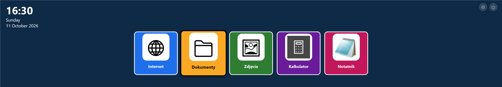
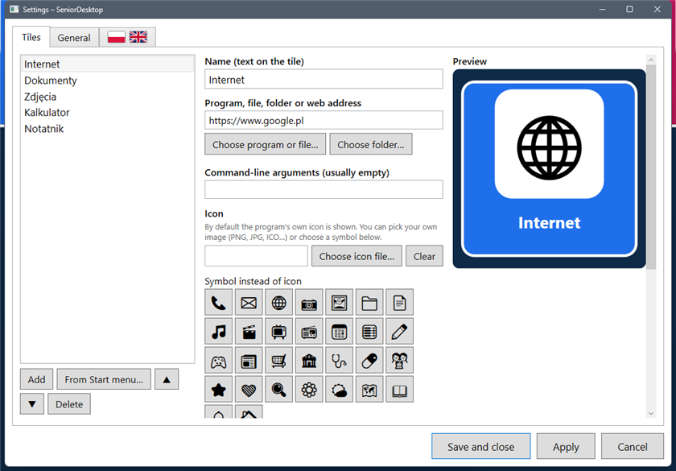
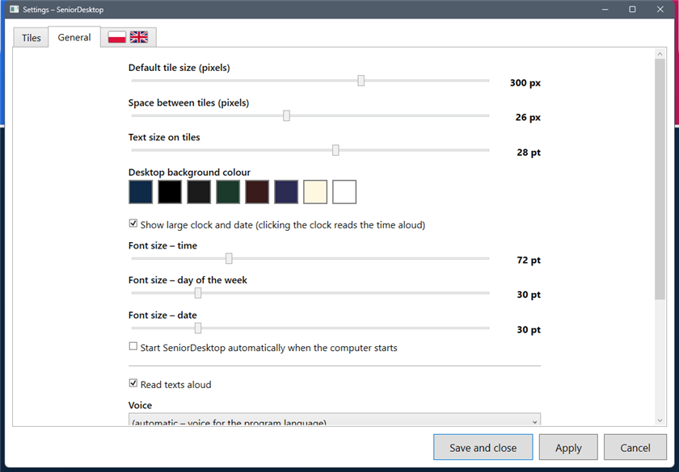
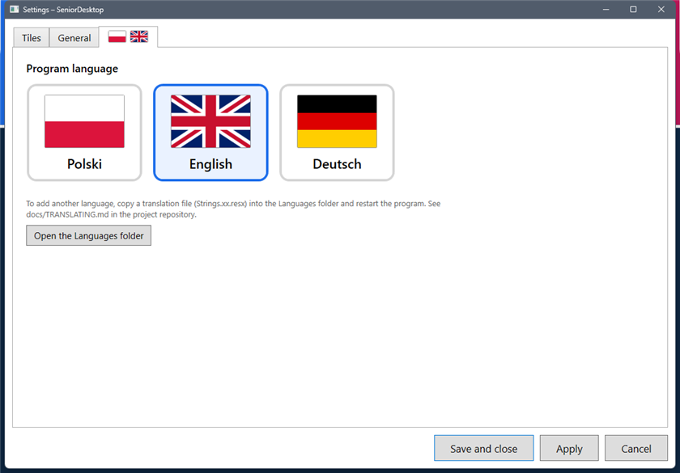

# SeniorDesktop

**A large-tile desktop overlay for Windows, made for visually impaired and elderly users.**

Desktop icons are small, easy to miss and easy to double-click by accident. SeniorDesktop covers the desktop with big,
high-contrast, square tiles — one click starts a program, optionally maximises its window and reads a short text aloud.
A caregiver configures everything once; the user only sees large buttons.

> ### 🤖 Built with heavy AI assistance
> This project was created in close collaboration with an AI assistant (**Claude**, by Anthropic). The AI wrote most of the
> code, the user-interface texts, the Polish / English / German translations and this documentation, based on requirements and
> feedback from the project owner, who directed the design and tried the program out. The code has had **limited human review**
> and has been tested mainly on Windows 11 with a single monitor. Please review it before relying on it, and treat the
> translations as unreviewed by native speakers. Issues and pull requests are welcome.



## Features

* **Big square tiles** (200 × 200 px by default) with a large icon and label. Size, spacing, text size, tile colours and the
  desktop background colour are configurable; each tile can also have its own size.
* **Per-tile settings**: program / file / folder / web address, command-line arguments, icon (the program's own icon, any
  image or icon file, or a symbol), colour, **maximise the program window after start**, and **text read aloud on start**.
* **Large clock** with the time, the day of the week and the date on separate lines, each with its own font size.
  Clicking the clock reads the time aloud.
* **Safe by design**: the settings button ⚙ and the exit button ⏻ must be *held* for one second. A shorter click shows a
  small hint for 3 seconds. Alt+F4 is blocked; tiles ignore repeated clicks while a program is starting.
* **Works like the real desktop**: sits right above the Windows desktop and below every program window, stays visible after
  *Show desktop* (Win+D) and never appears in the taskbar or Alt+Tab.
* **Languages**: Polish, English and German, chosen on a tab that shows flags instead of text. Translations are standard
  `.resx` files, and new languages can be added without recompiling — see [docs/TRANSLATING.md](docs/TRANSLATING.md).
* **Settings window** with live preview, **Apply** (applies changes without closing the window), Save and Cancel, and a
  picker for programs from the Start menu.
* Optional start with Windows. Text-to-speech uses the voices installed in Windows (it prefers a voice that matches the
  program language).

|                                    |                                    |
|------------------------------------|------------------------------------|
|  |  |
|  | |

## Getting started

1. Download `SeniorDesktop-<version>-win-x64.zip` from the [Releases](../../releases) page and unzip it anywhere.
   `SeniorDesktop.exe` is self-contained — **no .NET installation is needed**.
2. Run `SeniorDesktop.exe`. The first start creates five sample tiles in the language of your Windows.
3. Open the settings with a **one-second press on ⚙** (top right) or with **Ctrl + Shift + S**.
4. To turn the overlay off, **hold ⏻** for a second (or use *Settings → General → Close SeniorDesktop*).

Requirements: Windows 10 or 11, 64-bit. If the program does not start, see `%APPDATA%\SeniorDesktop\error.log`.

## Configuration

* Settings are stored in `%APPDATA%\SeniorDesktop\config.json` (plain JSON, easy to back up or copy to another PC).
* Additional / corrected translations: `%APPDATA%\SeniorDesktop\Languages\` or a `Languages` folder next to the exe.
* A configuration from the earlier working name of the project (`%APPDATA%\DuzyPulpit`) is migrated automatically.

## Building from source

Requires the [.NET 8 SDK](https://dotnet.microsoft.com/download/dotnet/8.0) on Windows.

```bash
git clone https://github.com/NepciorLab/SeniorDesktop.git
cd SeniorDesktop/Source
dotnet build            # debug build
build.cmd               # self-contained single-file SeniorDesktop.exe in the repository root
```

Project layout:

```
Source/                    WPF application (net8.0-windows)
  Languages/               Strings.resx (English), Strings.pl.resx, Strings.de.resx
  Localization/            .resx loader, {loc:Loc Key} XAML extension, vector flags
docs/                      documentation and screenshots
```

## Known limitations

* Windows 10/11 only (it is built on .NET 8). The overlay is placed on the primary monitor.
* *Maximise after start* works for programs with a normal resizable window; some applications restore their own size.
* The names and texts of the sample tiles are created in the language chosen on the first start; after that they are
  ordinary user data and are not re-translated when the language changes.
* Voices: the *Microsoft Server Speech* / desktop voices installed in Windows are used. More voices can be added in
  Windows Settings → Time & language → Speech.

## License

[MIT](LICENSE) © NepciorLab

---

## Po polsku

**SeniorDesktop** to nakładka na pulpit Windows dla osób niedowidzących i starszych: zamiast małych ikon pokazuje duże,
wyraźne, kwadratowe kafelki (domyślnie 200 × 200 px). Jedno kliknięcie uruchamia program, opcjonalnie maksymalizuje jego
okno i odczytuje na głos zadany tekst — osobno dla każdego kafelka. Opiekun konfiguruje wszystko raz, a użytkownik widzi
tylko duże przyciski.

* Ustawienia: przytrzymaj **⚙** przez sekundę lub naciśnij **Ctrl + Shift + S**. Wyłączenie: przytrzymaj **⏻** przez sekundę.
  Krótsze kliknięcie pokazuje na 3 sekundy podpowiedź.
* Okno ustawień ma przycisk **Zastosuj** (zmiany bez zamykania okna), podgląd kafelka i wybór programów z menu Start.
* Języki: polski, angielski, niemiecki — wybór na zakładce z flagami. Nowy język dodaje się plikiem `.resx` bez
  kompilowania programu ([docs/TRANSLATING.md](docs/TRANSLATING.md)).
* Wymagania: Windows 10/11 (64-bit). Plik `SeniorDesktop.exe` nie wymaga instalowania .NET.

> **Uwaga: duży udział AI.** Program, teksty interfejsu, tłumaczenia i dokumentację w znacznej części napisała sztuczna
> inteligencja (Claude, Anthropic) na podstawie założeń i uwag właściciela projektu. Kod nie przeszedł gruntownego przeglądu
> przez człowieka i był testowany głównie na Windows 11 — przejrzyj go przed użyciem, a tłumaczenia traktuj jako
> niesprawdzone przez native speakerów.
